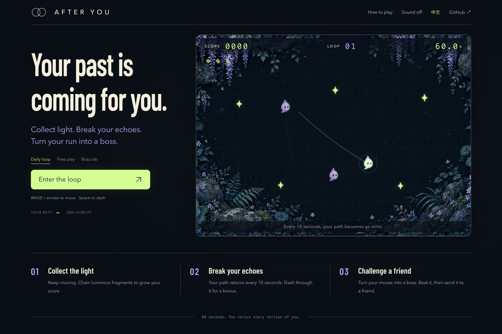

# AFTER YOU

**Dash through your past. Turn your moves into a friend's boss.**

A browser arcade game where your movements become the enemy. Survive a 60-second loop, then turn your run into a three-phase boss that a friend has 30 seconds to beat.

[中文说明](README.zh-CN.md) · [GitHub](https://github.com/LancerLSY/after-you) · [Contribute a mod](CONTRIBUTING.md) · [MIT code](LICENSE)

**[Owner preview](https://after-you-echo-arcade.lanceryou.chatgpt.site)** — currently private; public access is pending authorization. Run the complete game locally below.



## One minute. Every version of you.

- **Your moves. Their boss.** Build a boss from your actual path, beat it yourself, then send the playable challenge in a compact link.
- **Collect, then break.** Chain lights up to ×5. Dash through your echoes for a separate bonus. Three lives; one 60-second run.
- **Same lights. Your turn.** Daily challenges share a UTC-date seed. Send a challenge link or save a score card. Free play generates a fresh seed each run.
- **Replay what happened.** Watch your finished run, export its input recording, or recompute it with the DOM-free engine.
- **Play your way.** Keyboard, mouse-drag, and touch controls; English and Chinese; optional synthesized sound; reduced-motion support and automatic pause when you switch tabs.

No account, API key, AI service, package installation, or build step is needed. The game has zero runtime dependencies.

## Run locally

With **Node.js 20+**, run these commands from the project directory:

```sh
npm start
```

Open [http://127.0.0.1:4173](http://127.0.0.1:4173). The local server binds only to `127.0.0.1`; `PORT=4174 npm start` selects another port. The browser files in `dist/` can also be served by a static host.

```sh
npm test
npm run check
```

The 35 tests use Node's built-in runner and cover simulation, collisions, scoring, replay validation, Boss encoding and combat, and daily seeds. `npm run check` checks JavaScript syntax, asset references, and credential-like strings. Automated balance probes are development diagnostics, not human playtests or evidence of retention.

## Turn your run into a boss

1. Play for at least **8 seconds**, collect **3 lights**, and travel **600 arena units**. The result screen then offers **Turn my run into a boss**.
2. Beat the boss made from your movements. The normal sharing button unlocks only after you win this self-test.
3. Send the Boss link. Your friend faces **three phases in order, 3 HP each**, with **30 seconds total** and three lives. Dash to land nine hits; each collected light cuts the remaining dash cooldown by **0.35 seconds**.
4. An eligible run against that boss can become the next player's boss, too.

The Boss uses the first `min(30 seconds, run length)` of actual movement, split into three paths. Each path has 41 samples on a 4-unit grid and stretches to a ten-second loop. Its **339-character code** lives in the URL's `#boss` fragment; no upload service is needed. This is a sampled, quantized challenge, while the separate input replay reproduces the original simulation.

The self-test is a client-side sharing rule, not tamper-proof certification. The checksum detects corruption, not cheating; neither it nor a replay proves human play.

## Controls and classic scoring

| Action | Desktop | Touch |
|---|---|---|
| Move | WASD / arrows, or hold and drag inside the arena | Drag inside the arena like a joystick |
| Dash | Space | DASH button |
| Pause | Esc or pause button | Pause button |

Collect lights within four seconds of each other to increase the multiplier from ×1 to ×5. Each light gives `10 × multiplier` points and fades eight seconds after spawning. Damage resets the chain.

Every ten seconds, a new echo repeats the previous ten seconds of your path. Ordinary contact costs one life; a dash makes you invulnerable and shatters echoes. Dash lasts 0.18 seconds and recharges in 2.4 seconds. A shattered echo returns after two seconds, with a visible warning.

Each echo gives `50 + 10 × min(recorded lights, 8)` points once per ten-second cycle, provided you collected at least one light while recording that echo. Breaking it again still clears the danger but gives no extra points that cycle. Finish all 60 seconds after collecting light to receive `150 + 50 × remaining lives` bonus points.

## Seeds and honest replays

The simulation runs at 60 fixed ticks per second. The seed fixes the light schedule; recorded inputs reproduce the run under the same game rules. Replay files store a seed, version, mode, any Boss configuration, bounded inputs, and an advisory result. `runReplay()` calculates the result from the inputs and ignores a forged score in that metadata.

After saving a replay, it can be checked from a Node ES module:

```js
import { readFile } from 'node:fs/promises';
import { runReplay } from './dist/engine.js';

const replay = await readFile('after-you-replay.json', 'utf8');
const game = runReplay(replay);
console.log({ score: game.score, phase: game.phase, seconds: game.time });
```

Personal bests and preferences stay in your browser's local storage. Challenge-link scores are explicitly **self-reported**. There is no global leaderboard or server-side score verification. Recomputing a replay verifies its simulated result, not that a human played it.

## Make a different loop

`dist/` contains the editable source, not a generated bundle:

| File | Responsibility |
|---|---|
| [`dist/engine.js`](dist/engine.js) | Rules, seeded simulation, collision detection, replay import/export |
| [`dist/boss-codec.js`](dist/boss-codec.js) | Path sampling, compact Boss links, and validation |
| [`dist/renderer.js`](dist/renderer.js) | Canvas rendering, sprites, trails, and effects |
| [`dist/app.js`](dist/app.js) | Input, UI, languages, audio, sharing, and local storage |
| [`dist/style.css`](dist/style.css) | Layout, visual styling, and responsive controls |
| [`tests/engine.test.js`](tests/engine.test.js) | Simulation and replay regression tests |
| [`tests/boss.test.js`](tests/boss.test.js) | Boss encoding, combat, and replay regression tests |

Try a longer dash, a stricter collection window, a different echo rhythm, or an accessible visual theme. Keep rule-changing mods clearly named and separate from the original challenge scores. See [CONTRIBUTING.md](CONTRIBUTING.md) for the replay and testing contract.

Code is licensed under [MIT](LICENSE). Generated artwork and its provenance are documented in [docs/assets-provenance.md](docs/assets-provenance.md).
