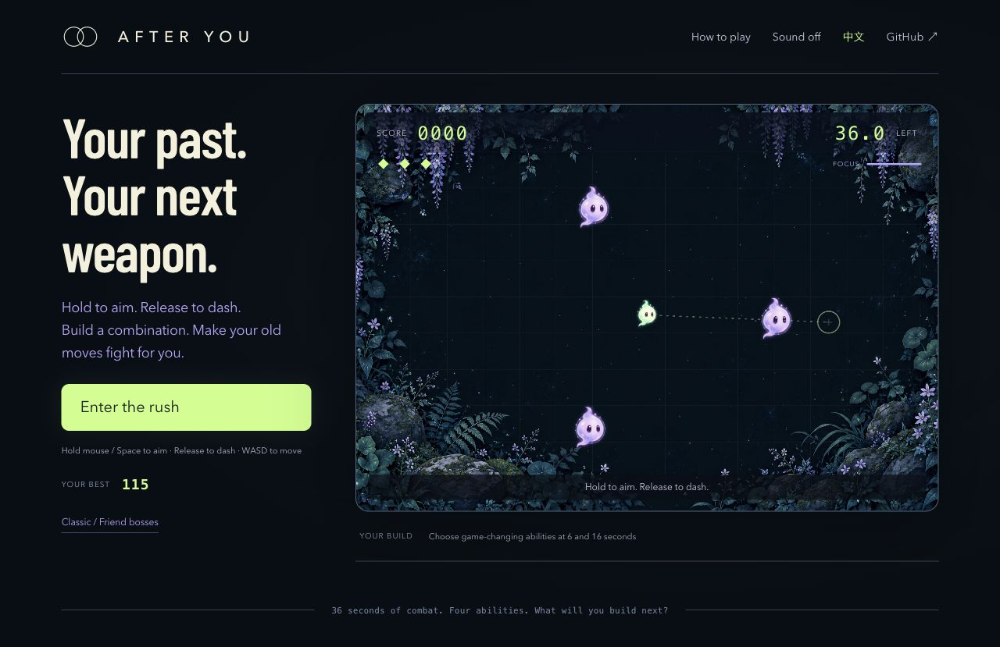

# AFTER YOU · 身后是你

**把过去，变成下一招。**

回声暴走是一局 36 秒的街机战斗。按住瞄准，松手冲刺，选择接力、折返、爆裂与剪枝，让自己的真实路线变成敌人或武器。击败终局回声才算获胜。

[English](README.md) · [GitHub 仓库](https://github.com/LancerLSY/after-you) · [贡献与玩法改造](CONTRIBUTING.md) · [MIT 代码许可](LICENSE)

**[直接开始试玩](https://after-you-echo-arcade.lanceryou.chatgpt.site)**

无需注册或安装，也可以按下方说明在本机运行。



## 回声暴走：让下一招换一种打法

新默认模式针对首轮试玩提出的“过程单调、缺少变化”修改战斗循环。

- 开场就有三个可击碎目标。按住鼠标或空格瞄准，松手冲刺；命中会返还冷却。
- 战斗第 6 秒和第 16 秒选择能力：**接力、折返、爆裂、剪枝**。接力精确复制你刚才的真实路线，折返改变路径几何，爆裂改变击杀范围，剪枝删除旧路线及其敌对回声。
- 慢动作专注有上限；瞄准仍消耗战斗时间，选择能力时暂停。
- 第 26 秒出现六点生命的终局回声，须在 36 秒前击败它。只绕圈生存无法获胜。
- 挑战链接分享种子与自报成绩，朋友可以尝试不同组合。Rush 回放包含输入和能力选择。

WASD / 方向键可移动，按住鼠标或空格瞄准，松手出招，Esc 暂停。原有 60 秒经典与好友 Boss 模式可从[经典 / 好友 BOSS](https://after-you-echo-arcade.lanceryou.chatgpt.site/?classic=1)进入；旧版挑战链接继续使用旧规则。

现有[14 秒脚本演示](https://after-you-echo-arcade.lanceryou.chatgpt.site/assets/launch-demo.webm)展示旧版经典 / Boss 玩法；短片导出也保留在这些模式中。机制与回放已做软件验证，复玩意愿仍需真人检验。


## 看示范、导出短片、离线游玩

**经典 / 好友 Boss 模式里的“先看一局示范”**会播放引擎重新计算的 Boss 回放，使用脚本操控，明确标注且不计入个人纪录。

在上述模式一局结束后选择**导出短片**，可把最后最多 14 秒制作成 720×960 的无声竖版视频。先预览，再点击**下载视频**。浏览器支持的格式为 WebM 或 MP4；录像不会上传。示范导出的短片保留“脚本示范”标记。

生成单文件离线版：

```sh
npm run build:portable
```

用现代浏览器打开 `output/after-you.html`。代码、美术和字体都已内嵌，生成的文件不需要本地服务器或安装依赖。浏览器权限等限制见[离线版说明](docs/portable.md)。这个本地构建不会发布网站或改变线上访问权限。


## 一分钟，对手是每个过去的你

- **你的走位，朋友的 Boss。** 用真实轨迹生成 Boss，自己先打赢，再用一个短链接把挑战交给朋友。
- **收集，再击碎。** 连续收光获得最高 ×5 倍率；冲刺穿过回声另得奖励。三条命，一局 60 秒。
- **同一片光点，换你来。** 每日挑战使用全球统一的 UTC 日期种子；分享挑战链接或保存成绩卡。自由练习每局生成新种子。
- **重看刚才那一局。** 观看自己的完整回放、导出输入记录，或用独立引擎重新计算结果。
- **随手开玩。** 支持键盘、鼠标按住拖动与触摸；中英双语、可选合成音效、减少动态效果，以及切换标签页自动暂停。

无需账号、API 密钥、AI 服务、安装依赖或构建。运行时依赖为零。

## 本机启动

安装 **Node.js 20+** 后，在项目目录执行：

```sh
npm start
```

打开 [http://127.0.0.1:4173](http://127.0.0.1:4173)。本地服务只监听 `127.0.0.1`；需要换端口时使用 `PORT=4174 npm start`。`dist/` 中的浏览器文件也可直接部署到静态网站托管服务。

```sh
npm test
npm run check
```

测试使用 Node 内置测试运行器，覆盖模拟、碰撞、计分、回放校验、Boss 编码与战斗，以及每日种子。`npm run check` 检查 JavaScript 语法、资源引用和疑似凭据字符串。自动化平衡性探针仅用于开发诊断，不是真人试玩或留存证据。

## 把自己的走位变成 Boss

1. 游玩至少 **8 秒**、收集 **3 颗光点**、累计移动 **600 个场地单位**，结算页就会出现“把我的轨迹变成 BOSS”。
2. 先击败自己的 Boss。正常界面中的分享按钮在自测通关后解锁。
3. 发出 Boss 链接。朋友要依次打完**三个阶段，每阶段 3 HP**；总限时 **30 秒**，自己有三条命。冲刺命中九次即可获胜；每收集一颗光点，剩余冲刺冷却减少 **0.35 秒**。
4. 挑战朋友 Boss 的这一局也能生成下一份 Boss，只要满足相同创建门槛。

Boss 取实际移动记录的前 `min(30 秒, 本局时长)`，等分为三段。每段采样 41 个点，坐标量化到 4 单位网格，再拉伸为十秒循环。**339 字符的编码**放在链接的 `#boss` 片段中，无需上传服务。这是经过采样与量化的挑战；单独的输入回放才用于重现原始模拟。

自测是客户端分享规则，不是不可绕过的认证。校验和用于检查数据损坏，不能防作弊；它和回放都不能证明由真人操作。

## 操作与经典模式计分

| 操作 | 电脑 | 触屏 |
|---|---|---|
| 移动 | WASD / 方向键，或按住场地拖动 | 在场地内像摇杆一样拖动 |
| 冲刺 | 空格 | DASH 按钮 |
| 暂停 | Esc 或暂停按钮 | 暂停按钮 |

每四秒内接着收集下一颗光点，倍率就从 ×1 逐步提升至 ×5。每颗光点得 `10 × 倍率` 分，出现八秒后消失。受伤会重置连击。

每十秒产生一道回声，重复你刚才十秒的真实轨迹。平时碰到回声会损失一条命；冲刺时无敌，并能击碎回声。冲刺持续 0.18 秒，冷却 2.4 秒。回声被击碎两秒后回来，复活前有可见预告。

若录制该段轨迹时收集过光点，击碎对应回声可得 `50 + 10 × min(录制时收光数, 8)` 分，每道回声每个十秒周期只给分一次。再次击碎仍能清除危险，但该周期不重复奖励。至少收集过一颗光点并坚持完整 60 秒，另得 `150 + 50 × 剩余生命数` 分。

## 种子与回放

引擎每秒固定模拟 60 步。种子决定光点时间表；在相同游戏规则下，录下的输入能重现这一局。回放文件包含种子、版本、模式、相应 Boss 配置、有长度限制的输入记录和参考结果。`runReplay()` 根据输入重新计算，不相信文件里自报的分数。

保存回放后，可以在 Node ES 模块中校验：

```js
import { readFile } from 'node:fs/promises';
import { runReplay } from './dist/engine.js';

const replay = await readFile('after-you-replay.json', 'utf8');
const game = runReplay(replay);
console.log({ score: game.score, phase: game.phase, seconds: game.time });
```

个人最佳和设置保存在浏览器本地。挑战链接中的分数明确标注为**玩家自报**。当前没有全球排行榜或服务器成绩认证；重算回放能验证模拟结果，不能证明由真人操作。

## 改造你自己的回环

`dist/` 中就是可编辑源码，不是构建生成的压缩包：

| 文件 | 职责 |
|---|---|
| [`dist/engine.js`](dist/engine.js) | 规则、种子模拟、碰撞与回放导入导出 |
| [`dist/boss-codec.js`](dist/boss-codec.js) | 轨迹采样、Boss 短链接与数据校验 |
| [`dist/renderer.js`](dist/renderer.js) | Canvas 绘制、精灵、轨迹与特效 |
| [`dist/app.js`](dist/app.js) | 输入、界面、语言、声音、分享和本地保存 |
| [`dist/style.css`](dist/style.css) | 布局、视觉样式和响应式控制 |
| [`tests/engine.test.js`](tests/engine.test.js) | 模拟与回放回归测试 |
| [`tests/boss.test.js`](tests/boss.test.js) | Boss 编码、战斗与回放回归测试 |

可以试试更长的冲刺、更紧的收集窗口、不同回声节奏或更易辨认的视觉主题。改变规则的版本应明确命名，与原版挑战成绩分开。回放兼容性及测试要求见 [CONTRIBUTING.md](CONTRIBUTING.md)。

代码采用 [MIT 许可](LICENSE)。生成美术的来源与说明见 [docs/assets-provenance.md](docs/assets-provenance.md)。

Rush 回放由 `dist/rush.js` 的 `exportRushReplay()` 记录输入和升级选择，使用 `runRushReplay()` 重算；其 kind 为 `rush`。经典 / Boss 的原版回放继续由 `dist/engine.js` 处理。
