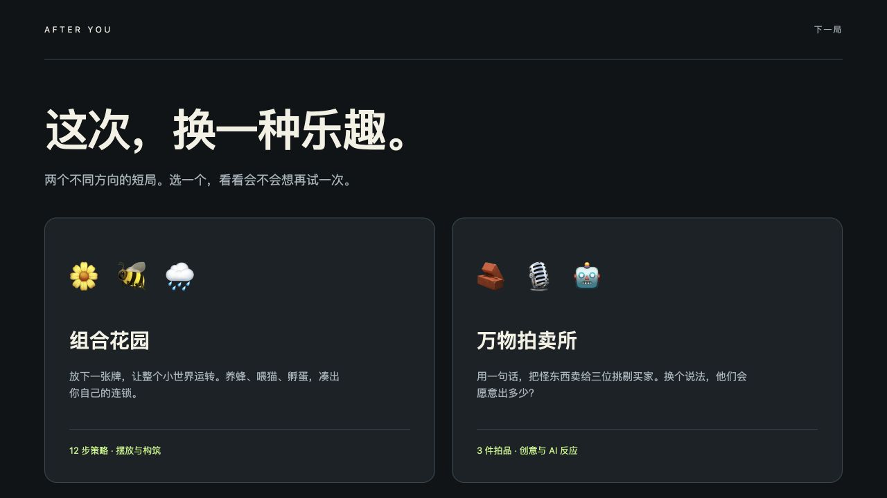

# Next-game prototypes

The second arcade playtest still did not earn another run. This lab tests two different sources of enjoyment before further arena-game polish. Neither prototype has demonstrated human replay motivation or viral growth.



## Play locally

```sh
npm run lab
```

Open [the lab](http://127.0.0.1:4178/lab/). There are no package dependencies. The server listens only on the local computer. `PROTOTYPE_PORT` selects another port.

### Combination Garden

Choose one of three tokens, then place it on a 4×4 board. Every placement activates the whole garden. Bees reward neighboring flowers; rain repeats flowers; cats consume fish; hens lay eggs; fire turns trees into ash that rain can regrow. Pay rent after every four placements, choose a rule-changing perk, and finish twelve placements.

The preview recomputes the actual next placement, including consumption, growth and rent. Perks change adjacency, activation and resource interactions. This is a seeded strategy prototype with a finite ending, rather than another survival timer.

### Odd Lot

Sell three absurd objects to a skeptical detective, an eccentric collector and a literal-minded robot. Pick a buyer to persuade, write a pitch, and compare three bids and their reasons. Only the winning bid pays. One repitch voucher lasts the whole run; an announced rule changes the following lot.

Without a server key, buyers use explicitly labeled, deterministic local rules. To use real DeepSeek buyers, start with `node prototype-server.mjs --key-stdin` and enter a key at the hidden prompt, or provide `DEEPSEEK_API_KEY` through your process environment. Never put a key in a browser, URL or tracked file. The UI states when a pitch will be sent to DeepSeek. A configured provider failure stays an error; it never silently becomes a local result.

The current provider is `deepseek-flash`, using bounded JSON output with thinking disabled. The server validates requests and quotes, canonicalizes implemented rule effects, restricts Host/Origin, bounds body size and call volume, and forwards cancellation. This local prototype is not a production AI gateway or a tamper-proof competition.

## Delivery and verification

The public homepage remains Echo Rush. These prototypes currently run locally; a static upload alone cannot provide the AI endpoint. Source can be served elsewhere, but the auction needs its server route for real buyers.

Browser checks completed a twelve-placement garden win and all three auction lots with actual DeepSeek responses. The latter run earned 1,330 coins; this is one test run, not a balance benchmark. Desktop and 390px phone layouts were checked. Automated tests cover immutable garden rules, preview agreement, auction transitions and scoring, provider validation, Unicode bodies, cancellation and visible error handling. They establish software behavior, not enjoyment.

The lab reuses the repository's native ES modules and Node test runner. It adds no dependencies, accounts, analytics, or published player claims.
